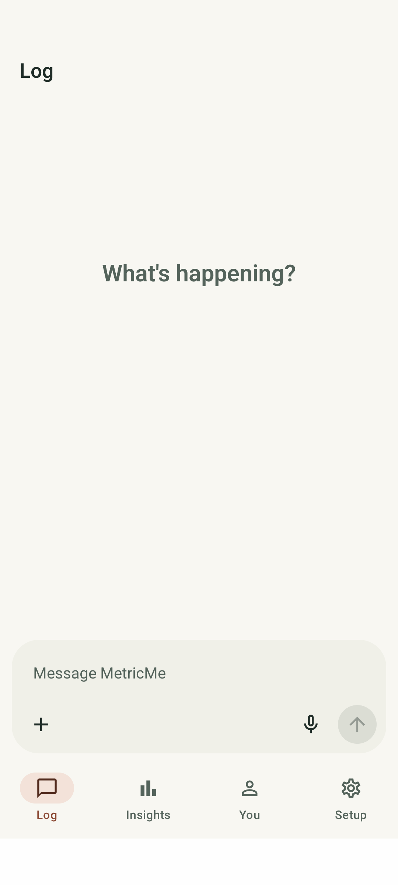
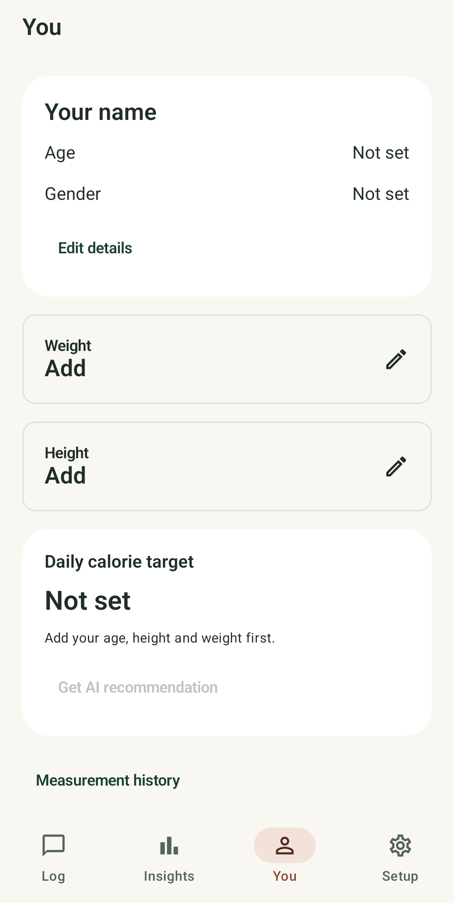

# MetricMe

A calm, local-first native Android habit and health journal. Kotlin, Jetpack Compose Material 3, Hilt, Room, and a pure Kotlin domain module.

**Current implementation: Android 0.5.1 guided AI journal.** Journal and AI capture share one screen for text, voice and photos. Useful, clarified statements become categorized, account-linked PostgreSQL records. Food needs consumed portions and a calorie estimate; essential missing details trigger repeated focused questions. Separate Log and Insights task state survives app recreation. Food estimates stay labelled and entries can be edited, undone or deleted. Insights query saved records and calculate descriptive summaries, rather than replaying a long chat. Offline manual logging remains available separately. See [the 0.5.1 guidance and verification notes](docs/ANDROID-0.5.1.md).




## Build

Use JDK 17 and an Android SDK with `platforms;android-37.0` and `build-tools;36.0.0`. Set `ANDROID_HOME`, or put `sdk.dir=/absolute/path/to/sdk` in the ignored `local.properties`. The Gradle wrapper pins 9.4.1 and verifies its distribution checksum. AGP 9.2.1 uses built-in Kotlin; do not add `org.jetbrains.kotlin.android`.

```powershell
.\gradlew.bat :domain:test :app:assembleDebug :app:assembleDebugAndroidTest :app:lintDebug
# With a running Android emulator or connected device:
.\gradlew.bat :app:connectedDebugAndroidTest
```

```sh
bash gradlew :domain:test :app:assembleDebug :app:assembleDebugAndroidTest :app:lintDebug
bash gradlew :app:connectedDebugAndroidTest
```

Debug APK: `app/build/outputs/apk/debug/app-debug.apk`. Test reports: `domain/build/reports/tests/test/`, `app/build/reports/`. GitHub Actions builds the app and runs instrumented tests on an API 35 emulator. A configured workflow is not evidence that CI has run; see the stage report for real results.

## Try the app

[Download MetricMe 0.5.1](https://metricme-downloads.vercel.app/MetricMe-0.5.1.apk). It can update the downloadable 0.3.1 build in place; the earlier 0.3.0 debug build has an incompatible signing key.

Open **Setup → Sign in with a code**, approve the code in your browser, and return to MetricMe. Public service settings are prefilled; Advanced connection settings support custom deployments. Never put an OpenAI key in Android.

The **Log** tab opens directly into a chat, with a microphone and an attachment menu for photos, camera and audio files. AI identifies the categories; there is no logging category picker. Speak, type or attach a photo and tap Send. After first-use consent, events with sufficient details are saved automatically under Food, Medication, Sleep, Activity, Water, Mood, Measurement or Note. Missing portion/preparation, dose, duration or other essential details get follow-up questions before the batch is saved. Each entry can be edited/deleted, and the latest saved batch can be undone.

**Insights** is a separate database-backed chat with Daily, Weekly and Monthly summary shortcuts, table responses, and a question composer. Ask “When did I last have a burger?” to retrieve the latest matching saved record. Meal names, notes, portions and exact times are kept for three calendar months; nutrition-only records remain for longer-term summaries. See [0.4.1 retention and lookup behavior](docs/ANDROID-0.4.1.md). These features provide descriptive retrieval and aggregates, not causal conclusions or medical advice. See [the 0.4.0 behavior and verification report](docs/ANDROID-0.4.0.md).

**You → Daily calorie target → Get AI recommendation** shares profile context after consent, then asks about physiology for the equation, usual activity, goal and whether a general estimate is suitable. The server calculates a reproducible starting estimate, which you must accept. Current profile and the dated accepted target can then inform Insights; profile changes invalidate the target. Gender identity is not used to infer physiology.

**Setup → Data settings → Offline records** preserves the earlier local journal, Log forms and reminders. These Room records stay separate from the cloud journal and are not silently uploaded or included in cloud summaries. Name, age (calculated from date of birth), gender, height and weight are in **You**. **Setup** contains AI sign-in and collapsed data settings; offline records, reminders, old AI drafts and sample mode are kept there. Read [the reminder behavior and limitations](docs/REMINDERS.md). Older photo/audio drafts remain accessible for migration; they retain the original explicit review/confirmation flow.

## Rules that matter

- Missing is distinct from zero. AI drafts will not count toward confirmed totals.
- Gender identity never selects the BMR coefficient. Optional physiological equation input is collected separately. Pregnancy/breastfeeding or a user preference can disable automatic calorie recommendations.
- Mifflin–St Jeor: `10 × kg + 6.25 × cm − 5 × completed age + coefficient`; coefficients +5 and −161. Activity multipliers 1.2, 1.375, 1.55, 1.725, 1.9 already include habitual activity. No automatic deficit or extra exercise calories.
- Target snapshots are dated; editing/deleting a measurement affects current estimates and creates a new snapshot today. Past snapshots remain intact. Manual targets stay until explicitly replaced.
- Measurements store instant and IANA zone. Latest instant wins, with a stable insertion sequence for ties. Backdated entries use local noon; a correction on the same date preserves its time. More than 30 days old is stale.
- Writes use UUID operation receipts and transactions. A retry with a changed payload is rejected; a repeated identical save returns the previous result.

## Legacy offline privacy and staged implementation

Notifications and microphone access are contextual and optional. Photo Picker needs no blanket storage permission; external camera capture uses a scoped FileProvider. Media stays private until the user explicitly consents to an authenticated upload. Room uses the Android app sandbox and device file-based encryption; it is **not separately database-encrypted**. Session state is separately encrypted with an Android Keystore key. Cloud backup and device transfer are excluded. No OpenAI key is embedded. Pending media expires after seven days, confirmed media within 24 hours, and deleted media immediately; force-stopped cleanup resumes on the next permitted run. Complete account deletion controls arrive in Stage 5. Do not enter sensitive real data into an unreviewed development build.

The legacy Stage 3 verification below is historical; current 0.4.0 checks are recorded in [the conversational journal report](docs/ANDROID-0.4.0.md). The Ktor API is live at [metricme-cc.vercel.app](https://metricme-cc.vercel.app) using the existing Java Docker image on Vercel. Liveness and Neon PostgreSQL readiness return 200, and protected routes reject unauthenticated requests with 401. The database uses Neon's Free plan. The server detects its OpenAI key and Auth0 configuration; device sign-in and live media processing remain unverified. Android UI ships as an APK. Railway previously rejected new provisioning with “Free plan resource provision limit exceeded,” and the user selected Vercel instead. No paid plan was enabled. The staged brief requires stopping after each stage until “continue.”

[Stage 3 Android checks and debug APK](https://github.com/hbhaq/metricme-cc/actions/runs/39152724736) · [Backend/PostgreSQL/container checks](https://github.com/hbhaq/metricme-cc/actions/runs/39152724727). **82 tests passed**: 29 domain, 9 shared contracts, 15 backend and 29 emulator tests, with no failures or skips. Lint: 0 errors, 9 warnings. The actual non-root deployment container passed its PostgreSQL/readiness/authentication smoke checks. APK version 0.3.0 is a development debug build; stable release/update signing remains Stage 5.

See [the approved planning document](STAGE-0-PLAN.md), [Stage 1 report](docs/STAGE-1-REPORT.md), [Stage 2 verification report](docs/STAGE-2-REPORT.md) and [Stage 3 verification report](docs/STAGE-3-REPORT.md).
