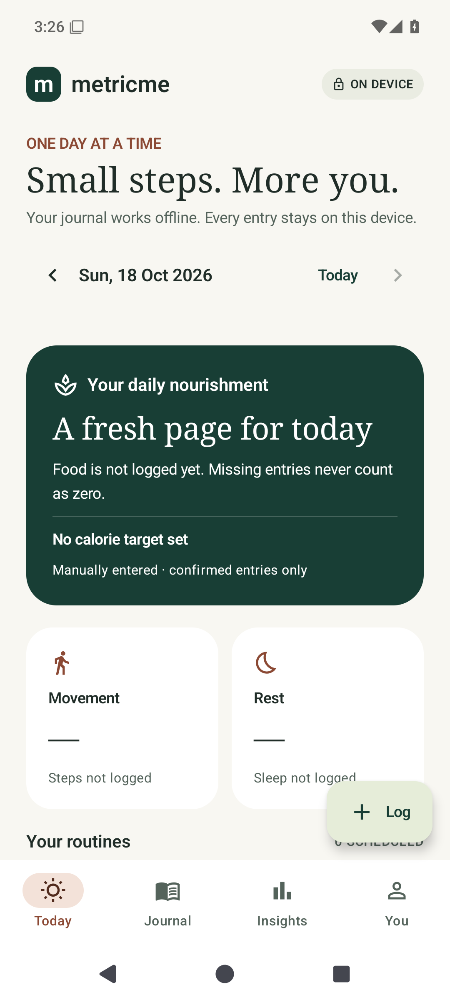
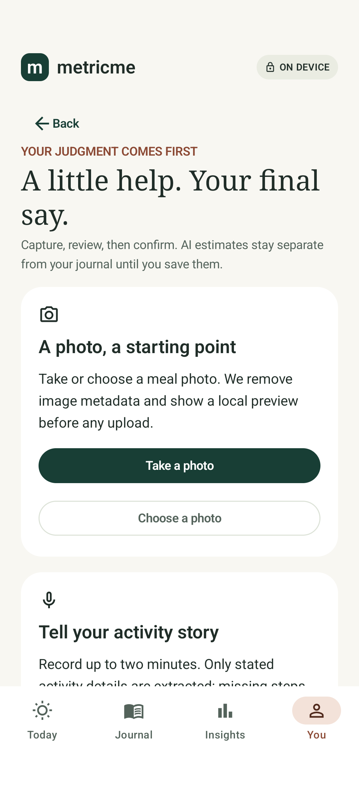

# MetricMe

A calm, local-first native Android habit and health journal. Kotlin, Jetpack Compose Material 3, Hilt, Room, and a pure Kotlin domain module.

**Current implementation: Stage 3.** Native offline logging and reminders now include private photo/audio drafts, editable AI review, consented offline uploads, OIDC sign-in and a Ktor/PostgreSQL backend. Verification is recorded in the stage report. Vercel is the selected API host; real AI stays locked until the database, server-side credentials and OIDC are configured. Analytics/coaching are Stage 4; final privacy/deletion and accessibility are Stage 5. Do not use this development build as medical advice.




## Build

Use JDK 17 and an Android SDK with `platforms;android-37.0` and `build-tools;36.0.0`. Set `ANDROID_HOME`, or put `sdk.dir=/absolute/path/to/sdk` in the ignored `local.properties`. The Gradle wrapper pins 9.4.1 and verifies its distribution checksum. AGP 9.2.1 uses built-in Kotlin; do not add `org.jetbrains.kotlin.android`.

```powershell
.\gradlew.bat :domain:test :app:assembleDebug :app:assembleDebugAndroidTest :app:lintDebug
# With a running Android emulator or connected device:
.\gradlew.bat :app:connectedDebugAndroidTest
```

```sh
bash gradlew :domain:test :app:assembleDebug :app:assembleDebugAndroidTest :app:lintDebug
bash gradlew :app:connectedDebugAndroidTest
```

Debug APK: `app/build/outputs/apk/debug/app-debug.apk`. Test reports: `domain/build/reports/tests/test/`, `app/build/reports/`. GitHub Actions builds the app and runs instrumented tests on an API 35 emulator. A configured workflow is not evidence that CI has run; see the stage report for real results.

## Try the app

Open Today → Set up your profile, or choose “Explore with sample data.” Demo is read-only and uses in-memory fixtures instead of inserting sample records into the personal database. Exit demo to return to your records. Add kg/cm measurements from You; imperial display is optional. History supports correction and deletion. Manage target supports manual values or a maintenance estimate when inputs are available. All forms offer Cancel and preserve unfinished edits through recreation.

Use **Log** for food, activity/workouts, daily steps, sleep, habits/vitamins or medications. Optional nutrition/duration/step fields stay unknown when blank. Food nutrition describes the full entered quantity; portion consumed scales it. Workout lines use `exercise | sets | reps | load in kg`, with unknown fields left blank. Journal supports date navigation, corrections and confirmed deletion. Sleep belongs to the wake-up date; overlapping sessions require confirmation and do not count shared minutes twice.

Open **You → Habits, medications & reminders** to manage routines and enable optional notifications. Scheduled occurrences are tracked separately, as-needed use is recorded separately, and a missed alert does not imply a missed dose. Read [the reminder behavior and limitations](docs/REMINDERS.md).

Use **Log → Photo or audio draft**, or **You → Photo, audio & private drafts**. Take/select a photo or record a short activity note, keep it locally, optionally add context, and explicitly consent before queuing an upload. Review/edit the result and confirm before it enters totals. Food batches save as independently editable entries in one transaction. Cancelled/deleted drafts cannot be populated by late results. Demo mode offers labeled local sample reviews without credentials or personal writes.

See [deployment and sign-in setup](docs/DEPLOYMENT.md) for the Vercel container service, Ktor API, PostgreSQL, server variables and public Android connection settings. No OpenAI key belongs in Android.

## Rules that matter

- Missing is distinct from zero. AI drafts will not count toward confirmed totals.
- Gender identity never selects the BMR coefficient. Optional physiological equation input is collected separately. Pregnancy/breastfeeding or a user preference can disable automatic calorie recommendations.
- Mifflin–St Jeor: `10 × kg + 6.25 × cm − 5 × completed age + coefficient`; coefficients +5 and −161. Activity multipliers 1.2, 1.375, 1.55, 1.725, 1.9 already include habitual activity. No automatic deficit or extra exercise calories.
- Target snapshots are dated; editing/deleting a measurement affects current estimates and creates a new snapshot today. Past snapshots remain intact. Manual targets stay until explicitly replaced.
- Measurements store instant and IANA zone. Latest instant wins, with a stable insertion sequence for ties. Backdated entries use local noon; a correction on the same date preserves its time. More than 30 days old is stale.
- Writes use UUID operation receipts and transactions. A retry with a changed payload is rejected; a repeated identical save returns the previous result.

## Privacy and scope

Notifications and microphone access are contextual and optional. Photo Picker needs no blanket storage permission; external camera capture uses a scoped FileProvider. Media stays private until the user explicitly consents to an authenticated upload. Room uses the Android app sandbox and device file-based encryption; it is **not separately database-encrypted**. Session state is separately encrypted with an Android Keystore key. Cloud backup and device transfer are excluded. No OpenAI key is embedded. Pending media expires after seven days, confirmed media within 24 hours, and deleted media immediately; force-stopped cleanup resumes on the next permitted run. Complete account deletion controls arrive in Stage 5. Do not enter sensitive real data into an unreviewed development build.

The Ktor API is live at [metricme-cc.vercel.app](https://metricme-cc.vercel.app) using the existing Java Docker image on Vercel. Liveness and Neon PostgreSQL readiness return 200, and protected routes reject unauthenticated requests with 401. The database uses Neon's Free plan; real AI remains disabled until server credentials and OIDC are configured. Android UI ships as an APK. Railway previously rejected new provisioning with “Free plan resource provision limit exceeded,” and the user selected Vercel instead. No paid plan was enabled. The staged brief requires stopping after each stage until “continue.”

[Stage 3 Android checks and debug APK](https://github.com/hbhaq/metricme-cc/actions/runs/39152724736) · [Backend/PostgreSQL/container checks](https://github.com/hbhaq/metricme-cc/actions/runs/39152724727). **82 tests passed**: 29 domain, 9 shared contracts, 15 backend and 29 emulator tests, with no failures or skips. Lint: 0 errors, 9 warnings. The actual non-root deployment container passed its PostgreSQL/readiness/authentication smoke checks. APK version 0.3.0 is a development debug build; stable release/update signing remains Stage 5.

See [the approved planning document](STAGE-0-PLAN.md), [Stage 1 report](docs/STAGE-1-REPORT.md), [Stage 2 verification report](docs/STAGE-2-REPORT.md) and [Stage 3 verification report](docs/STAGE-3-REPORT.md).
